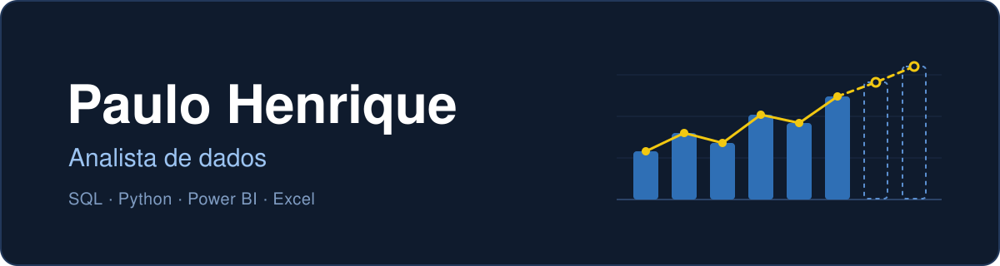

  

  

## Ferramentas

  

## Projetos

<table>
  <tr>
    <td width="50%" valign="top">

### [House Rocket](https://github.com/phfreitass/house_rocket_project_insight)

Encontra imóveis à venda abaixo do preço médio da região e sugere o preço de revenda de cada um.

`Python` `Pandas` `Plotly` `AWS`

</td>
    <td width="50%" valign="top">

### [Rossmann Sales Predict](https://github.com/phfreitass/rossamann-sales-predict)

Previsão de vendas diárias por loja para as próximas seis semanas, com promoções, feriados e concorrência entre as variáveis. Em andamento.

`Python` `Pandas` `Seaborn`

</td>
  </tr>
</table>

O problema de negócio e as ferramentas de cada projeto estão detalhados no [portfólio](https://phfreitass.github.io/portfolio_projetos/).

## Estatísticas

<picture>
<source media="(prefers-color-scheme: dark)" srcset="https://github-readme-stats.vercel.app/api?username=phfreitass&show_icons=true&hide_border=true&locale=pt-br&theme=github_dark">

</picture>
<picture>
<source media="(prefers-color-scheme: dark)" srcset="https://github-readme-stats.vercel.app/api/top-langs/?username=phfreitass&layout=compact&hide_border=true&locale=pt-br&theme=github_dark">

</picture>

## Contato

  
  
  

